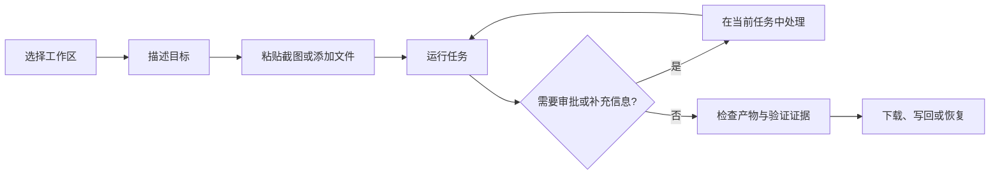

# GoFlow V3 快速使用指南

版本：V3

适用平台：Windows 10/11 x64 的 PC Web 平台。

本地启停、故障排查与安全清理见[本机操作与维护](./local-operations.zh-CN.md)；无需在 GitHub 上阅读。

适用对象：不想先学习 Agent、MCP 或工作流配置，只希望把任务交给本地智能体完成的普通用户；以及需要把重复任务沉淀为流程的开发、网安、运维和文档人员。

这份指南面向第一次使用 GoFlow 的普通用户。正式的产品定位、架构、安全模型、质量标准和实践方法，请阅读 [GoFlow V3 本地智能体工作流平台使用与实践白皮书](./goflow-v3-whitepaper.zh-CN.md)。

## 1. 先记住这一条

GoFlow 的主入口是“任务”，不是资源配置页面。



普通任务不需要先创建工作流，也不需要手动选择模型、沙箱参数或子智能体。系统会根据目标、附件、工作区和风险自动选择内置资源。只有需要重复执行、固定阶段、分支、审批或团队交接时，才进入工作流画布。

## 2. 安装与启动

### 2.1 使用发布包

发布包只支持 Windows x64，不需要 Docker、Podman 或虚拟机。

Windows：

```powershell
cd D:\Apps\GoFlow
.\run-goflow.cmd D:\Projects\my-project
```

启动日志出现服务就绪后，打开：

```text
http://127.0.0.1:8080/console
```

工作流画布地址为：

```text
http://127.0.0.1:8080/workflows
```

本地服务默认只监听本机。不要把 `http://` 写成 `https://`。如果 8080 已被占用，可以使用开发启动方式指定其他端口，例如 `--http 127.0.0.1:65210`。

### 2.2 从源码启动（开发者）

```powershell
go run ./cmd/goflow --workspace D:\Projects\my-project --http 127.0.0.1:8080
```

普通用户不需要安装 Go。开发启动只用于二次开发、诊断和测试。

### 2.3 第一次打开页面

按下面顺序完成初始化：

1. 在“设置”中填写模型服务 API Key。
2. 在“任务”中选择实际项目或资料所在的工作区。
3. 先运行一个只读任务，确认模型连接和工作区无误。
4. 再执行需要修改文件、运行命令或生成文档的任务。

模型、推理强度和供应商地址以本地设置为准，兼容中转供应商的模型标识。Key 保存为本地密钥引用，不应写进任务描述、工作流文件、截图或 Git 提交。

## 3. 第一次任务：五步完成

### 第一步：确认工作区

工作区是本次任务允许读取和交付文件的范围。运行前确认：

- 选中的是项目根目录，而不是临时目录或上一级目录。
- 需要保留的未提交修改已经存在于该目录中。
- 不要把包含 API Key、SSH 私钥或个人资料的目录当作工作区。

如果任务可能读写文件，GoFlow 会要求确认工作区。确认后，文件工具、Diff、产物和恢复记录都会绑定到这次任务。

### 第二步：写清楚目标

推荐使用“目标、范围、交付、验收、限制”五段式：

```text
目标：修复当前工作区中的登录接口 500 错误。
范围：只检查 auth/ 和相关测试，不修改数据库结构。
交付：源码修改、测试结果、变更说明和运行方式。
验收：go test ./... 通过，保留真实 Diff，不得留下临时文件。
限制：先分析再修改；需要删除或访问网络时先在任务中请求审批。
```

简单任务可以只写一句话。复杂任务尽量明确范围和验收条件，系统会据此决定是否拆成工作流。

### 第三步：添加截图和文件

任务输入框支持：

- `Ctrl+V` 直接粘贴截图。
- 把图片或文件拖入输入区。
- 通过文件按钮选择多个附件。
- 在发送前预览和删除附件。
- 使用 `@相对路径` 精确引用工作区内的文本文件。

截图会作为任务附件保存并带有哈希。模型端点不支持视觉时，平台会明确提示，不会把 OCR 或模型自评伪装成识图结果。需要识别截图时，应使用通过视觉能力检测的 Provider。

截图任务示例：

```text
我粘贴了一张浏览器报错截图。请在当前工作区定位对应页面和接口，说明根因，提出最小修改，运行相关测试，并交付修改文件、Diff 和验证结果。不要只描述截图。
```

### 第四步：运行并处理审批

点击“运行”后，页面会显示当前动作摘要、阶段、工具结果和需要用户处理的事项。

- 只读检查通常可以直接执行。
- 写入文件、执行命令、访问网络、修改主机或远程操作可能需要审批。
- 审批就在当前任务或当前工作流中完成，不需要切换到单独的审批页面。
- 看不清影响范围时，先展开审批详情，确认目标、工作区、文件和风险，再批准。
- 不确定时选择拒绝或取消，任务会保留状态，不会偷偷继续。

“批准本阶段后续同类调用”只对显示的任务、阶段和作用域生效，不会变成全局授权。

### 第五步：检查交付

任务成功必须有真实证据。根据任务类型检查：

- 文件或文档是否真的生成或修改。
- Diff 是否只包含预期文件。
- 构建、测试、静态检查或文档校验是否真实执行。
- 报告、引用、日志、截图或运行结果是否可回放。
- 是否列出风险、未完成项和恢复方式。

任务变更会直接出现在已确认的真实工作区，因此可以立即使用项目自身环境运行和测试。需要在任务结束后继续人工访问 Web 项目时，软件开发智能体可以启动受管开发进程，并返回进程编号和地址；该进程随 GoFlow 生命周期管理。确认交付质量后可点击“保存当前工作区版本”；系统默认保留最近 3 个版本。需要撤销时点击“回退到上一版本”，系统会先检查任务结束后是否又有人工修改，避免静默覆盖。

## 4. 怎样提出高质量任务

### 4.1 简单任务

适合直接交给任务入口：

- “读取 `@README.md`，找出安装步骤错误，只修改文档并做链接校验。”
- “分析当前 Go 项目的构建失败，修复最小范围代码，运行相关测试。”
- “检查本机磁盘和服务状态，只读诊断，不执行变更。”
- “把这份 Markdown 资料整理成带来源的 Markdown、JSON 和 CSV。”

### 4.2 复杂任务

复杂任务应该描述最终交付，而不是要求模型“多想几轮”：

```text
请对当前仓库做一次发布前准备：
1. 建立代码库地图并识别构建入口；
2. 检查依赖、配置、测试和静态检查；
3. 只修复能够由证据确认的问题；
4. 生成变更 Diff、测试报告、风险清单和发布说明；
5. 最终必须给出可运行的构建命令和未解决问题。
除非需要审批，不要重复读取相同文件或进行没有产物的模型调用。
```

系统会在内部使用子智能体、上下文检索、检查点和质量门，但用户不需要手动安排讨论顺序。

### 4.3 让任务更快、更省 Token

- 给出准确的工作区和文件路径，不要把整个磁盘作为范围。
- 使用 `@path` 引用必要文件，避免在提示中粘贴大段重复内容。
- 说明“只读”“允许修改哪些目录”“必须运行哪些检查”。
- 指定交付格式，例如“输出 DOCX、PDF、Diff 和测试日志”。
- 不要要求模型重复总结已经存在于运行详情中的内容。
- 对重复工作使用工作流或 Skill，不要每次从零描述相同步骤。

## 5. 五类内置能力怎么用

### 5.1 开发编码

适合：定位 Bug、实现功能、重构、补测试、依赖检查、构建发布。

推荐写法：

```text
请修复当前 Go 服务的超时错误。先定位调用链和现有测试，只修改必要文件；完成后运行相关 go test、go vet 和格式检查，交付 Diff、测试输出和回滚说明。
```

质量门通常包括真实文件变化、构建、测试、静态检查和 Diff 审查。没有真实验证的“看起来正确”不会被当作完成。

### 5.2 网络安全

必须先说明授权范围、目标、时间窗口和允许的动作：

```text
授权范围：本地测试仓库和 http://127.0.0.1:9000，测试窗口为今天 14:00-16:00。
目标：被动检查认证、输入校验和依赖风险。
交付：发现、证据、风险等级、修复建议、复测结果和报告。
禁止：拒绝服务、越权访问、真实生产目标和未授权凭据。
```

外部网页和工具返回均按不可信数据处理。需要主动网络动作时，页面会在当前任务中请求审批。

### 5.3 网络运维

先从只读诊断开始，再决定是否变更：

```text
请检查当前主机上的服务状态、端口监听、磁盘和最近错误日志。先只读诊断，输出证据和可能原因；任何配置修改、重启服务或远程 SSH 操作都必须先审批，并提供回滚方案。
```

远程主机必须明确选择目标。网络配置修改应包含备份、变更前检查、干跑、执行、健康检查和恢复验证。

### 5.4 互联网资料核验

```text
请核验“主题”在指定日期前的公开资料。优先官方文档和原始论文，记录 URL、发布日期、访问时间、关键原文、冲突观点和无法确认的内容，交付 Markdown、JSON 和 CSV。
```

资料智能体会做来源去重、引用映射和冲突标记。没有来源的推断不能作为已核验事实。

### 5.5 Office/WPS 文档

文档能力不只负责新建，也支持读取、模板修改、精确修改、保留格式、合并和 PDF 导出。

模板修改示例：

```text
读取 @templates/report.docx，保留页眉、页脚、目录、表格和样式，只将“项目名称”“负责人”“结论”替换为下面内容。不要重排其他段落。输出修改后的 DOCX、PDF 预览和校验说明。
```

报告生成示例：

```text
根据本次网安任务的证据生成正式报告：沿用 @templates/security-report.docx 的格式，补充执行范围、发现、证据、风险、修复和复测；合并附件中的表格，导出 DOCX 和 PDF，并校验页数、标题和表格没有丢失。
```

完成后检查源文件、预览/PDF、结构校验和格式保留结果。不要只接受聊天窗口中的文字。

## 6. 工作流：什么时候需要，怎么设计

### 6.1 什么时候使用工作流

以下情况适合进入“工作流”：

- 任务有固定阶段和明确交接。
- 需要审批、检查点、重试、分支或并行。
- 任务会反复执行，例如发布检查、资料核验或周期报告。
- 需要把一个复杂交付拆成可恢复的工作切片。

一次性的小修复不需要先画工作流，直接使用任务入口更快。

### 6.2 最小设计方法

在“工作流”页面：

1. 新建或选择一个工作流。
2. 从节点库添加开始、执行和结束节点。
3. 连接节点，保持一条清晰主路径。
4. 选中执行节点，只填写执行者、技能、输入、输出和下一步。
5. 只有需要分支、审批、重试、证据或质量门时，才展开高级配置。
6. 点击“校验”，修复缺少入口、出口、引用或验收条件的问题。
7. 保存后用一条真实小任务试运行，再投入正式任务。

最小可用结构：

```text
开始 -> 分析 -> 实现/处理 -> 验证 -> 质量门 -> 交付 -> 结束
```

节点配置的核心含义：

| 字段 | 作用 |
| --- | --- |
| 智能体 | 谁负责这一步 |
| 技能 | 按什么方法完成 |
| 输入 | 从任务或上游节点读取什么 |
| 输出 | 给下游发布什么稳定结果 |
| 下一步 | 正常完成后去哪 |
| 审批 | 是否需要人工确认 |
| 产物 | 需要保留的报告、Diff 或证据 |
| 验收条件 | 什么证据才能继续或交付 |

不要为了“看起来复杂”添加多个没有独立产物的子智能体，也不要用模型调用替代确定性的文件检查、测试、哈希或格式校验。

### 6.3 工作流运行与恢复

运行时画布会标出当前节点、暂停点、分支和质量门。需要输入或审批时，在当前运行控制区处理。关闭页面、重启服务后，可以从“任务记录”恢复已保存运行；系统会从最近检查点继续，不会无条件重复已经完成的阶段。

## 7. 资源页面怎么理解

普通用户只需要认识五类资源：

| 资源 | 作用 | 什么时候改 |
| --- | --- | --- |
| 智能体 | 领域角色和任务判断 | 需要新的稳定领域角色时 |
| 子智能体 | 边界明确的子任务 | 需要独立产物或并行检查时 |
| 工作流 | 固定阶段、审批和质量门 | 任务会重复或需要恢复时 |
| Skill | 可复用的方法、脚本和验收规则 | 需要沉淀一套做法时 |
| 连接 | MCP 工具或外部能力入口 | 需要新增本地工具时 |

内置资源优先使用。导入外部资源时，常见兼容文件包括 `SKILL.md`、`AGENTS.md`、`CLAUDE.md` 和标准 MCP stdio 配置；平台会保留安全边界，不能因为“兼容”而绕过审批或工作区限制。

连接配置通常只需要中文名称、命令、启用状态和必要参数。第三方连接默认使用 `auto` 原生受控执行，普通用户不需要填写 AppContainer、ACL、Landlock、seccomp、namespace 或 cgroup 参数。

## 8. 安全与数据边界

- 不使用 Docker、Podman 或虚拟机作为产品运行时。
- GoFlow 在 Windows 本地运行。Linux 主机可作为经授权的远程目标，不需要安装 GoFlow。
- 获批的文件、命令和 MCP 工具在已确认的真实工作区内运行，以便使用项目虚拟环境和依赖；原生沙箱仍禁止越过该目录。
- 默认不允许工具直接写真实工作区以外的路径。
- 写文件、命令、网络、主机或远程操作按风险要求审批。
- 任务前只读快照、Diff、逐文件日志和最近 3 个工作区版本用于安全回退；回退前必须通过当前文件哈希检查。
- API Key、SSH 私钥和敏感环境变量不应出现在提示、日志、报告或提交中。

如果系统报告宿主不具备完整强沙箱能力，未知代码会被拒绝并显示原因，而不是静默降级到不受控进程。

## 9. 失败、恢复和常见问题

### 页面打不开

确认服务进程仍在运行，访问 `http://127.0.0.1:<端口>/console`，检查端口是否被占用。服务默认是 HTTP，不是 HTTPS。

### 401 或鉴权失败

在“设置”重新填写当前有效的模型服务 Key。不要把 Key 写进 YAML、截图或聊天内容。服务日志不会显示完整 Key。

### 400 模型无效

实际模型以当前模型服务配置为准。如果返回模型错误，应核对服务地址、支持的模型名称和 Key 是否匹配，并执行连接测试。

### 任务一直等待

查看当前任务中的审批、工作区确认或人工输入提示。处理后点击继续；不要重新提交同一任务造成重复执行。

### 任务失败

先查看失败阶段和真实错误，再选择重试或恢复。若失败发生在验证阶段，优先只重试验证；若工作区被外部修改，先重新确认 Diff 和工作区状态。

### 产物不完整

查看质量门、验收条件和运行详情。没有文件、Diff、测试、来源或校验证据的模型文字不算正式交付。

### MCP 连接不可用

检查连接是否启用、命令是否存在、运行环境是否满足，以及宿主原生沙箱能力是否就绪。未知连接在强边界不可用时会被拒绝，这是安全策略，不是自动切换到不受控模式。

## 10. 交付前检查表

提交或下载结果前，逐项确认：

- [ ] 目标工作区正确，未误读或误改其他目录。
- [ ] 任务范围、授权范围和限制已明确。
- [ ] 真实文件、Diff 或文档产物已经生成。
- [ ] 构建、测试、静态检查、来源核验或格式校验已经执行。
- [ ] 审批记录、运行详情和关键证据可以回放。
- [ ] 产物路径、下载文件和恢复编号清楚。
- [ ] 风险、未完成项和后续操作已经列出。
- [ ] 没有 API Key、私钥或敏感数据泄露。

## 11. 进一步阅读

- [安装与部署](./install.zh-CN.md)
- [配置说明](./configuration.zh-CN.md)
- [资源与设置指南](./resources.zh-CN.md)
- [工作流图](./workflows.zh-CN.md)
- [Skill](./skills.zh-CN.md)
- [MCP](./mcp.zh-CN.md)
- [原生 MCP 隔离](./mcp-isolation.zh-CN.md)
- [架构说明](./architecture.zh-CN.md)
- [发布与校验](./release.zh-CN.md)
